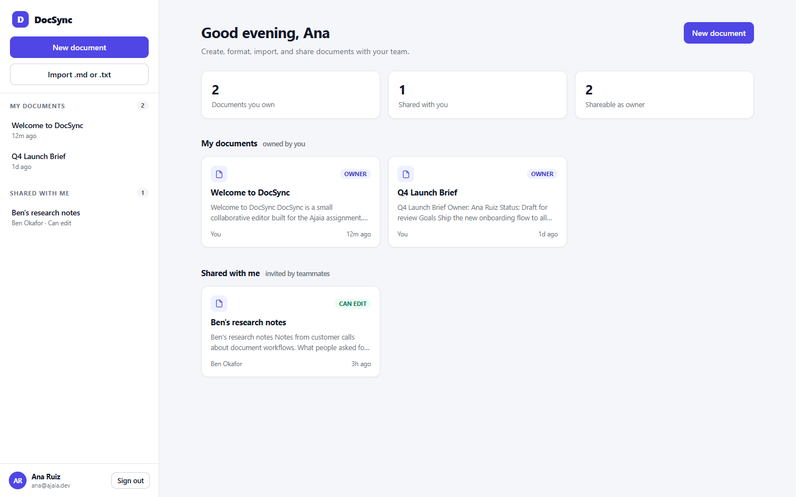

# DocSync

A small, working collaborative document editor built for the Ajaia AI-native full stack assignment. Create a document, format it, import Markdown or plain text, share it with a teammate as a viewer or editor, and come back to it later — everything persists.

**Live demo:** `https://<your-service>.onrender.com` _(replace after deploying — see [Deploying to Render](#deploying-to-render))_
**Demo password for every seeded account:** `demo1234`



---

## What is included

| Assignment requirement | Status | Notes |
| --- | --- | --- |
| Create a document | ✅ | New documents start with an empty editor |
| Rename a document | ✅ | Inline title field, saves on blur or after a pause |
| Edit rich text | ✅ | Headings (H1–H3), bold, italic, underline, strike, bulleted + numbered lists, blockquote, links, code |
| Save and reopen | ✅ | Autosave (900 ms debounce), Ctrl/Cmd + S, explicit save status |
| File upload | ✅ | Import `.md`, `.markdown`, `.txt` (≤ 2 MB) into a new editable document |
| Owner + sharing | ✅ | Owner invites a seeded user by email as **Viewer** or **Editor** |
| Owned vs shared distinction | ✅ | Separate sidebar sections and role badges |
| Persistence | ✅ | SQLite database, formatting stored as structured Quill Delta JSON |
| Validation and error handling | ✅ | Field validation, role checks, upload limits, JSON error envelope |
| Automated tests | ✅ | 7 API tests + a real-browser smoke test |
| Deployment | ✅ | `Dockerfile` + `render.yaml` (Render free tier) |
| Architecture note | ✅ | [`ARCHITECTURE.md`](ARCHITECTURE.md) |
| AI workflow note | ✅ | [`AI_WORKFLOW.md`](AI_WORKFLOW.md) |

**Intentionally not built:** realtime co-editing, comments, version history, `.docx`/PDF import, PDF export, attachments, password reset, pagination. Rationale in [ARCHITECTURE.md](ARCHITECTURE.md#scope-decisions).

---

## Quick start

Requires **Node.js 24+** (the app uses the built-in `node:sqlite` module — no native build step).

```bash
npm install
npm start
```

Open <http://localhost:3000>. The database is created and seeded automatically on first boot at `data/docsync.db`.

```bash
npm test        # 7 API tests against a throwaway database
npm run smoke   # real-browser end-to-end flow + screenshots (needs Edge or Chrome)
```

### Seeded accounts

| Name | Email | Password | Seeded access |
| --- | --- | --- | --- |
| Ana Ruiz | `ana@ajaia.dev` | `demo1234` | Owns *Welcome to DocSync* and *Q4 Launch Brief* |
| Ben Okafor | `ben@ajaia.dev` | `demo1234` | Editor on *Welcome*, viewer on *Q4 Launch Brief*, owns *Ben's research notes* |
| Cara Lin | `cara@ajaia.dev` | `demo1234` | No access initially — use her to prove sharing works |

The login screen has one-click buttons for each account, so reviewers do not need to type anything.

---

## Two-minute review flow

1. **Sign in as Ana** → open **Welcome to DocSync**.
2. Select text and apply **bold / italic / underline**, add a heading or a list. Watch the save status change to *Saved HH:MM*.
3. Click **Share** → invite `cara@ajaia.dev` as **Viewer** → invite `ben@ajaia.dev` as **Editor**.
4. **Sign out → sign in as Cara** → open the document under *Shared with me*. She sees a **View only** banner, a read-only title, and no Share/Delete controls.
5. **Sign in as Ben** → the same document is editable; he cannot share or delete it.
6. Click **Import .md or .txt** and pick a Markdown file → it opens as a new document with headings and lists preserved.
7. Refresh the page at any point — content, formatting, and sharing all survive.

### Sharing and permissions

| Action | Owner | Editor | Viewer | Unrelated user |
| --- | --- | --- | --- | --- |
| Open document | ✅ | ✅ | ✅ | 404 |
| Edit content / rename | ✅ | ✅ | 403 | 404 |
| Share / revoke access | ✅ | 403 | 403 | 404 |
| Delete document | ✅ | 403 | 403 | 404 |
| Export Markdown | ✅ | ✅ | ✅ | 404 |

Permissions are enforced in the API, not just hidden in the UI. Users with no access receive **404** rather than 403 so document existence is not leaked.

---

## File import

- Accepted: `.md`, `.markdown`, `.txt`
- Maximum size: **2 MB**
- Encoding: UTF-8 (a BOM is tolerated)
- Markdown support: headings, bulleted/numbered lists, blockquotes, fenced code, bold, italic, inline code, and `http(s)`/`mailto` links
- Rejected with a clear message: other extensions, empty files, binary files, files over the limit
- The imported file becomes a **new document owned by the uploader**; the original upload is not stored

`.docx` and PDF are deliberately out of scope — parsing them reliably needs another dependency and more time than the timebox allowed.

---

## Persistence

- SQLite via Node's built-in `node:sqlite`, file at `data/docsync.db` (WAL mode, foreign keys on).
- Documents store **Quill Delta JSON**, not HTML. Formatting round-trips exactly and there is no stored-HTML XSS surface.
- Sharing lives in a `shares` table keyed by `(document_id, user_id)` with a `viewer`/`editor` role.
- Demo data is seeded only when the `users` table is empty. To reset the demo: stop the server, delete the `data/` directory, start again.

### Environment variables

| Variable | Default | Purpose |
| --- | --- | --- |
| `PORT` | `3000` | HTTP port (Render injects its own) |
| `DOCSYNC_DATA_DIR` | `./data` | Directory for the database and session secret |
| `DOCSYNC_DB` | `<data dir>/docsync.db` | Full database path override |
| `SESSION_SECRET` | generated + persisted | Signs session cookies; set this in production |
| `COOKIE_SECURE` | auto on Render | Force `Secure` cookies when serving over HTTPS |

---

## Deploying to Render

The repo includes a Render Blueprint (`render.yaml`) that uses Render's native Node runtime, plus a `Dockerfile` for other platforms.

1. Push this repository to GitHub.
2. In Render: **New + → Blueprint**, select the repo. Render reads `render.yaml` and creates a Node web service with a generated `SESSION_SECRET`, `COOKIE_SECURE=true`, and a health check at `/healthz`.
   - Manual alternative: **New + → Web Service → Node**, build `npm ci --omit=dev`, start `node src/server.js`, health check `/healthz`, add `SESSION_SECRET` and `DOCSYNC_DATA_DIR=/opt/render/project/src/data`.
3. Wait for the first deploy, open the URL, and sign in with a seeded account. The first boot seeds the demo data automatically.
4. Replace the placeholder live URL in this README, `SUBMISSION.md`, and `VIDEO_URL.txt` with your service URL.

### Free-tier behaviour (important)

> The database uses persistent local storage, but zero-downtime redeploys or long idle periods may reset the seed state to default demo data.

- Free Render services **spin down after ~15 minutes of inactivity**; the next request takes 30–60 seconds to wake.
- Free instances have an **ephemeral filesystem**. Documents survive page refreshes and normal use, but a redeploy or restart can start from an empty disk, which re-runs the demo seed.
- For durable storage, uncomment the `disk:` block in `render.yaml` (requires a paid instance type) or point `DOCSYNC_DATA_DIR` at a mounted volume.

### Docker locally

```bash
docker build -t docsync .
docker run -p 3000:3000 -v docsync-data:/app/data -e SESSION_SECRET=local-secret docsync
```

---

## Project structure

```
src/
  app.js        Express app factory (security headers, static files, error handler)
  server.js     Process entry point (port, graceful shutdown)
  db.js         SQLite connection, schema, first-boot seed, session secret
  auth.js       scrypt sessions, signed cookies, requireAuth middleware
  routes.js     REST API: auth, documents, sharing, import, export
  markdown.js   Markdown <-> Quill Delta conversion
  password.js   scrypt hash/verify
  seed-cli.js   Schema/seed bootstrap helper
public/
  index.html    SPA shell
  app.js        Hash-routed UI: login, list, editor, sharing, import
  styles.css    Design system and layout
  vendor/       Quill 2.0.3 (vendored so the app works offline)
test/
  api.test.js   Node test runner + real HTTP against a temp database
scripts/
  smoke.mjs     Playwright smoke test in headless Edge/Chrome
docs/screenshots/
```

---

## Tests

```bash
npm test
```

Runs seven integration tests over real HTTP against a temporary SQLite database:

1. Health check, anonymous access, login/logout, invalid password.
2. Create → rename → save Delta → reload preserves formatting; invalid title/content rejected.
3. Sharing grants access; editor can write; viewer is read-only; revocation is immediate; unrelated users get 404.
4. Sharing validates unknown users, self-shares, invalid roles, invalid emails.
5. Markdown import preserves headings/lists/bold; PDF, empty, and missing files rejected.
6. Markdown export returns the right filename and content.
7. Only owners can delete; non-collaborators cannot discover the document.

```bash
npm run smoke
```

Boots the real app on port 3100 with a throwaway database and drives Edge/Chrome through login → edit → autosave → reload → share → view-only → import → export. It fails on any console or page error, checks for horizontal overflow, and writes screenshots to `docs/screenshots/`. Set `EDGE_PATH` if your browser lives somewhere unusual.

---

## Known limitations

- **No realtime collaboration.** Two people editing the same document is last-write-wins; the UI does not claim otherwise.
- **No optimistic concurrency control.** Autosave serialises writes per tab, but two tabs editing the same document can overwrite each other.
- **Free-tier persistence is best-effort** (see above).
- **No CSRF token.** Mitigated by `SameSite=Lax` cookies, JSON-only request bodies, and same-origin `fetch`; a production build should add an explicit token.
- **Demo accounts are public** by design so reviewers can test sharing instantly. Passwords are still scrypt-hashed, but there is no signup, reset, or rate limiting.
- **No pagination or search** — fine for a seeded demo, not for thousands of documents.
- Preview text is recomputed per document on list requests.

### Next 2–4 hours

1. Optimistic concurrency (`version` column + 409 conflict banner) so two tabs cannot clobber each other.
2. Realtime presence and live cursors (Yjs or a simple WebSocket broadcast) — the highest-value product addition.
3. Comment threads anchored to text ranges.
4. `.docx` import via `mammoth`, plus PDF export.
5. Persist attachments to object storage with signed download URLs.
6. Rate limiting on login, CSRF tokens, and audit logging for share changes.

---

## Troubleshooting

| Symptom | Fix |
| --- | --- |
| `npm` is blocked in PowerShell (`npm.ps1 cannot be loaded`) | Use `npm.cmd install` / `npm.cmd start`, or run `Set-ExecutionPolicy -Scope Process Bypass` |
| `node:sqlite` module not found | Use Node 24+ (`node -v`); `nvm use` picks up `.nvmrc` |
| Port 3000 already in use | `PORT=4000 npm start` (PowerShell: `$env:PORT=4000; npm.cmd start`) |
| Login succeeds but you are bounced back to sign-in | You are on plain HTTP with `COOKIE_SECURE=true`; unset it or serve over HTTPS |
| Want a clean demo | Stop the server, delete `data/`, restart |

---

## Documentation

- [ARCHITECTURE.md](ARCHITECTURE.md) — priorities, data model, access control, tradeoffs
- [AI_WORKFLOW.md](AI_WORKFLOW.md) — how AI tools were used, changed, and verified
- [SUBMISSION.md](SUBMISSION.md) — deliverable checklist and review credentials
- [VIDEO_SCRIPT.md](VIDEO_SCRIPT.md) — 4-minute walkthrough script
